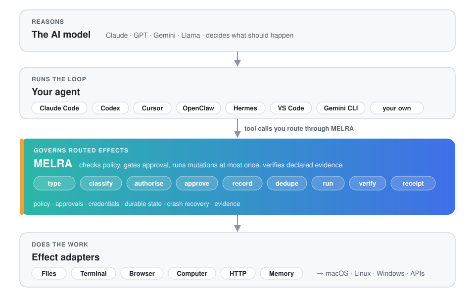
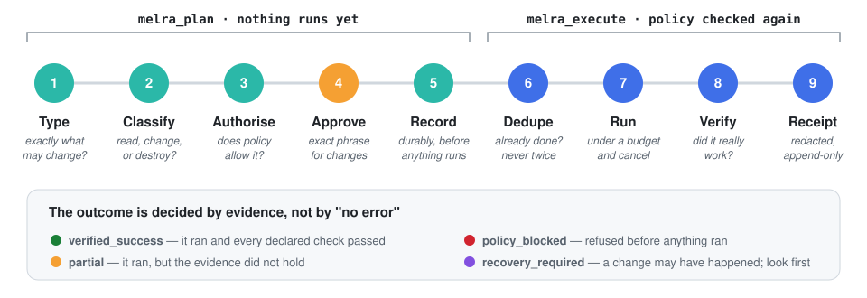
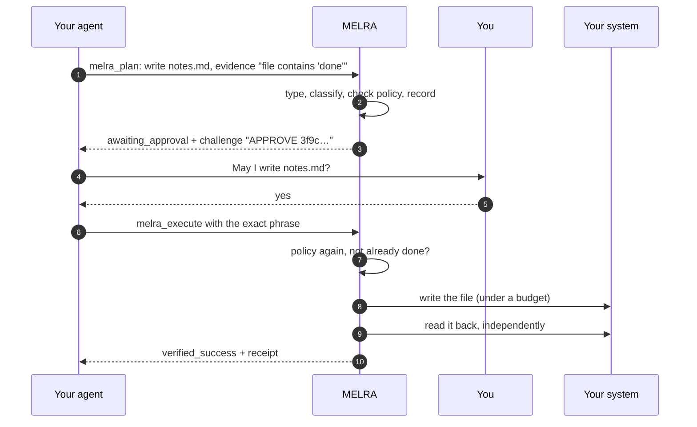
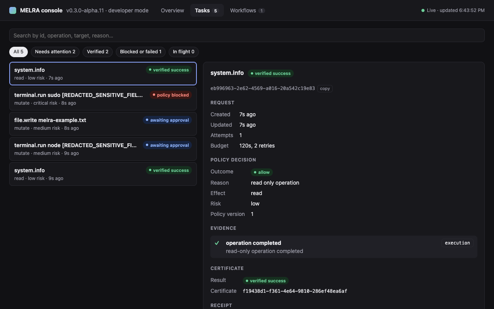

<div align="center">


# MELRA

**M**odular **E**xecution **L**ayer for **R**eliable **A**utonomy

### Your AI agent decides what to do. MELRA governs how tool calls are authorized, verified, and recovered.

An open-source local execution runtime for agent tool calls you route through MELRA.
It checks each call against policy, requests approval when needed, verifies declared
evidence, and keeps a redacted receipt of what runs to an outcome. For each task, MELRA
dispatches mutations at most once; uncertain outcomes are parked for reconciliation
instead of replay. Exactly-once external effects still depend on the provider. Calls
made through other tools remain outside MELRA's control.

<br />

<!-- Build & quality (live) -->
<a href="https://github.com/XAGI-Lab/melra/actions/workflows/ci.yml"></a>
<a href="https://github.com/XAGI-Lab/melra/actions/workflows/codeql.yml"></a>
<a href="https://github.com/XAGI-Lab/melra/actions/workflows/audit.yml"></a>
<a href="https://github.com/XAGI-Lab/melra/actions/workflows/container.yml"></a>

<!-- Release & project -->
<a href="https://github.com/XAGI-Lab/melra/releases"></a>
<a href="https://www.npmjs.com/package/@melra/cli"></a>
<a href="https://registry.modelcontextprotocol.io/v0.1/servers/io.github.XAGI-Lab%2Fmelra/versions/latest"></a>
<a href="https://www.tensorblock.co/mcp/servers/github-xagi-lab-melra-62b49341"></a>
<a href="https://mcpservers.org/servers/xagi-lab/melra"></a>
<a href="https://mcp.site/servers/melra"></a>
<a href="https://smithery.ai/servers/xagi-labs/melra"></a>
<a href="LICENSE"></a>


<!-- Platforms & stack -->


<br /><br />

**Works with** &nbsp;


<br /><br />

[**26-second demo**](#26-second-demo) &nbsp;·&nbsp; [**Quick start**](#quick-start) &nbsp;·&nbsp; [**How it works**](#how-it-works) &nbsp;·&nbsp; [**See what it is doing**](#see-what-it-is-doing) &nbsp;·&nbsp; [**Docs**](#documentation) &nbsp;·&nbsp; [**Contribute**](#contributing) &nbsp;·&nbsp; [**Discussions**](https://github.com/XAGI-Lab/melra/discussions) &nbsp;·&nbsp; [**Product Hunt launch**](https://www.producthunt.com/products/melra)

<br />


</div>

<br />

### 26-second demo

https://github.com/user-attachments/assets/e5cf895d-7ea6-4797-a1ef-e69cc5860d3f

<br />

> [!WARNING]
> **MELRA is alpha software.** The local runtime is tested end to end, but APIs may
> change before `1.0`. Use an isolated workspace, keep domain and command allowlists
> narrow, and read every approval before you give it.

---

## Quick start

You need **Node.js 22.13 or newer, or 23.4 or newer**. From the project the agent
should work in, one command sets everything up:

```bash
cd ~/project
npx @melra/cli@alpha setup
```

That directory becomes the agent's workspace, the boundary for its file and command
operations. `setup` shows it, and asks before making your home directory, a directory
holding it, or `/` the workspace; set `MELRA_WORKSPACE` to choose another.

In a terminal, `setup` is a short wizard. It writes a safe local policy, finds the
agent apps on your machine, asks which one should use MELRA, and writes MELRA into
that app's own config file, keeping everything else in it (and saving a `.bak` first):

```text
Which MCP client should use MELRA?

  1)   Claude Code                      detected: 'claude' on PATH
  2)   Cursor                           detected: config file found
  3)   Gemini CLI                       detected: config folder found
  ...

Choose 1-26 [1]: 1
Write it into ~/project/.mcp.json? [Y/n]

  ✓  Workspace    ~/project
  ✓  Policy       ~/.melra/policy.json
  ✓  Claude Code  ~/project/.mcp.json

Next: Start claude in this workspace and approve the 'melra' server when it asks; 'claude mcp list' then shows it connected.
```

Then restart your agent app (Claude Code asks you to approve a project's server
once) and ask it to do something, for example *"use melra to
show me the system info"*. That's it.

<details>
<summary><b>Prefer flags, a container, or building from source?</b></summary>

<br />

| How | Command |
|---|---|
| One client, no questions | `npx @melra/cli@alpha setup --client cursor --write` |
| Print the config instead of writing it | `npx @melra/cli@alpha setup --client codex` |
| Install globally | `npm install -g @melra/cli@alpha && melra setup` |
| Container (no Node needed) | `docker run --rm ghcr.io/xagi-lab/melra:alpha doctor` |
| Prebuilt release | download from [releases](https://github.com/XAGI-Lab/melra/releases), verify against `SHA256SUMS`, then `node melra/dist/bin.js doctor` |
| From source | `git clone https://github.com/XAGI-Lab/melra.git && cd melra && corepack enable && pnpm install --frozen-lockfile && pnpm build && pnpm melra setup` |
| One file, no Node needed *(experimental)* | from a checkout: `pnpm build:sea`, then `./dist-sea/melra setup`; see [single executable](docs/INSTALLATION.md#single-executable-experimental) |
| Check what you installed | `npm audit signatures` verifies registry signatures; npm provenance links each package to its GitHub Actions build (see [npm packages](docs/INSTALLATION.md#npm)) |

Every command prints readable output in a terminal and plain JSON when piped or with
`--json`, so scripts keep working. MELRA creates `<MELRA_HOME>/payload.key` with
private permissions on first start; back it up with the SQLite files, because losing
it makes persisted payloads unreadable. See [installation](docs/INSTALLATION.md) for
every install path, environment variable, and the hardened Docker invocation.

</details>

> [!CAUTION]
> This project publishes only under the `@melra/` npm scope (`@melra/cli` is the CLI)
> and on its [releases](https://github.com/XAGI-Lab/melra/releases), where the Python
> SDK's wheel is. An **unscoped** npm package `melra` or a PyPI package `melra` is
> **not this project's**. Install from that scope, from this repository, or from the
> releases.

If MELRA helps, [star the repository](https://github.com/XAGI-Lab/melra) so other
agent builders can find it. Trying it in Cursor or another client? Share the client
and its version, your OS, and your MELRA version (`npx @melra/cli@alpha version`) in
[issue #184](https://github.com/XAGI-Lab/melra/issues/184); partial test results are
useful too.

---

## What is MELRA?

AI agents no longer just talk. They edit files, run commands, click through websites
and call APIs on your behalf. Four questions come with that, and most agents answer
them differently, or not at all:

<table>
<tr>
<td width="25%" valign="top">

### 🛡️ Is it allowed?

Every action MELRA receives is checked against **your** policy, and checked again at
the moment it runs. Risky changes wait for your exact approval.

</td>
<td width="25%" valign="top">

### ✅ Did it really work?

"No error" is not success. An action counts only when the **evidence you declared**
holds: the file exists, the exit code is 0, the page says what it should.

</td>
<td width="25%" valign="top">

### 🔁 What if it crashes?

Every mutation MELRA dispatches is **recorded before it runs** and runs **at most
once**. After a crash, MELRA settles it from its evidence or the provider; what it
cannot settle waits in `recovery_required` and is never replayed.

</td>
<td width="25%" valign="top">

### 🧾 What happened?

Every action MELRA runs to an outcome leaves a **redacted, hash-linked receipt**, so
you can audit what ran, who asked, and why it was allowed.

</td>
</tr>
</table>

MELRA answers those questions in one place for tool calls routed through it, across
supported agents. It sits underneath your agent for those calls, the way an operating
system sits underneath your apps:

<p align="center">
  
</p>

> **The LLM reasons. The harness manages the loop. MELRA governs the effect lifecycle
> for calls routed through it.** Swap the model or the agent; MELRA's policies,
> approvals, credentials, history and receipts can stay in place.

---

## Works with your agent

MELRA speaks the [Model Context Protocol](https://modelcontextprotocol.io), so any MCP
client can use it. For these, `melra setup --client <name>` writes the config in the
client's own format and location, and `melra doctor` tells you whether each one is
pointed at MELRA:

| Agent | `--client` | Config it writes |
|---|---|---|
|  **Claude Code** | `claude-code` | `<project>/.mcp.json` |
|  **Claude Desktop** | `claude-desktop` | `claude_desktop_config.json` |
|  **OpenAI Codex CLI** | `codex` | `~/.codex/config.toml` |
|  **Cursor** | `cursor` | `~/.cursor/mcp.json` |
| 🟦 **VS Code** (Copilot agent mode) | `vscode` | `<project>/.vscode/mcp.json` |
|  **Gemini CLI** | `gemini` | `~/.gemini/settings.json` |
|  **Windsurf** | `windsurf` | `~/.codeium/windsurf/mcp_config.json` |
|  **Zed** | `zed` | Zed `settings.json` (comments kept) |
| 🧩 **Cline** | `cline` | Cline's `cline_mcp_settings.json` |
| ⬛ **OpenCode** | `opencode` | `~/.config/opencode/opencode.json` |
| 👻 **Kiro** | `kiro` | `~/.kiro/settings/mcp.json` |
| 🪿 **Goose** | `goose` | `~/.config/goose/config.yaml` |
| ▶️ **Continue** | `continue` | `<project>/.continue/mcpServers/melra.yaml` |
| ⚡ **Amp** | `amp` | `~/.config/amp/settings.json` |
| 🦞 **OpenClaw** | `openclaw` | `~/.openclaw/openclaw.json` (`mcp.servers`) |
| ⚕️ **Hermes Agent** (Nous Research) | `hermes` | `~/.hermes/config.yaml` (`mcp_servers`) |
|  **GitHub Copilot CLI** | `copilot` | `~/.copilot/mcp-config.json` |
| 🐉 **Qwen Code** | `qwen` | `~/.qwen/settings.json` |
| 🅰️ **Auggie** (Augment) | `auggie` | `~/.augment/settings.json` |
|  **Warp** | `warp` | `~/.warp/.mcp.json` |
|  **Junie** (JetBrains) | `junie` | `~/.junie/mcp/mcp.json` |
| 🤖 **Factory Droid** | `droid` | `~/.factory/mcp.json` |
| 🌙 **Kimi Code** | `kimi` | `~/.kimi-code/mcp.json` |
| 🪁 **Kilo Code** | `kilo` | `~/.config/kilo/kilo.jsonc` (comments kept) |
| 🧪 **LM Studio** | `lmstudio` | `~/.lmstudio/mcp.json` |
| 🔌 **Anything else** | `generic` | prints the standard `mcpServers` block |

Building your own agent? Use the [TypeScript SDK](packages/sdk-ts) or the
[Python SDK](sdk-py). Both can spawn MELRA or connect to one that is already running
over loopback HTTP or a private Unix socket. For agent frameworks, see the
[framework examples](examples/frameworks/README.md): LangChain / LangGraph, the
OpenAI Agents SDK, the Vercel AI SDK, and the official MCP SDKs.

> [!NOTE]
> A named client is marked **verified** only after the *released package*, not a
> source checkout, passes discovery, planning, approval, execution, cancellation and
> receipt retrieval in that client. Per-client status lives in
> [COMPATIBILITY.md](docs/COMPATIBILITY.md).

---

## How it works

An **effect** is one bounded operation an agent routes through MELRA: `file.write`,
`terminal.run`, `browser.click`, `http.request`, and so on. MELRA handles each routed
effect in nine stages, split between a plan step and an execute step (for a single
task, `melra_plan` then `melra_execute`) so that **nothing runs at planning time**:

<p align="center">
  
</p>

Here is one change from start to finish, in developer mode. In
[enforced mode](docs/INSTALLATION.md#deployment-modes) the challenge carries no
phrase: you approve with `melra approve <task-id>` outside the conversation,
and the agent's `melra_execute` sends no approval at all.



**What the final status means**, and what an agent should do next:

| Status | Meaning | Next step |
|---|---|---|
| 🟢 `verified_success` | It ran and every declared check passed | Done |
| 🟡 `partial` | It ran, but the evidence did not hold | Look at the evidence, then decide |
| 🔴 `policy_blocked` | Refused before anything ran | Read the reason; the same request will be refused again |
| 🔵 `awaiting_approval` | A change is waiting for your approval | Developer mode: approve it from the agent that planned it. Enforced mode: `melra approve <task-id>` |
| ⏳ `waiting_user` | It ran and every check MELRA can make passed; a `semantic` question waits for an answer from outside | Nothing can answer it yet; it settles closed at expiry |
| 🟣 `recovery_required` | A change may or may not have happened, or happened and its `semantic` question went unanswered | **Check the world first**; never re-run blindly |
| ⚪ `failed` · `cancelled` · `budget_exhausted` | It did not complete | Safe to plan again |

<details>
<summary><b>Show the request an agent actually sends</b></summary>

<br />

The agent resolves "run the checks" into one bounded operation, plus the evidence that
would prove it worked:

```json
{
  "goal": "Run the repository checks",
  "operation": { "kind": "terminal", "action": "run", "command": "pnpm", "args": ["check"] },
  "requiredEvidence": [{ "type": "exit_code", "value": 0 }]
}
```

The task reaches `verified_success` only if the process exits `0`. A process that runs
and exits `1` completed the action but failed the evidence, so it is reported as
`partial`. MELRA never receives a goal like *"fix the production server"*: that needs
judgement, which belongs to the model. A kernel that interpreted sentences would be a
kernel whose guarantees depended on a model.

</details>

When an agent connects, MELRA also sends it a short guide to this loop (the MCP
server's `instructions`), so a model knows to declare evidence, read the status, and
never blindly retry an unknown outcome, without anyone prompt-engineering it.

---

## See what it is doing

You can see each action MELRA handled and its policy decision, and, for each that ran
to an outcome, its evidence and receipt, from the terminal or the browser. Nothing here
can approve or start work, and approval phrases are never displayed.

<table>
<tr>
<td width="50%" valign="top">

**From the terminal**

```text
$ melra status
MELRA 0.3.0-alpha.16  developer mode
  Tasks       3 total: 1 awaiting_approval,
              1 policy_blocked, 1 verified_success
  Waiting     1 waiting for approval
  HTTP        127.0.0.1:7457 not running

$ melra tasks
ID        STATUS             OPERATION     UPDATED
64199678  awaiting_approval  file.write    0s ago
ca4aec7a  policy_blocked     terminal.run  1s ago
a1285e0f  verified_success   system.info   1s ago

$ melra watch          # live, until Ctrl-C
6:07:21 PM  task 882cf55c  verified_success
6:07:22 PM  task f813364c  awaiting_approval
```

`melra doctor` checks Node, SQLite, the browser and policy, and reports which of your
agent apps point at MELRA, with the one command that fixes anything wrong.

</td>
<td width="50%" valign="top">

**In the browser:** `melra serve --http --open`



An overview, a searchable task list, and durable workflows with a live event stream.
It works at phone width and in light and dark, and it is served with a strict
Content-Security-Policy.

</td>
</tr>
</table>

---

## Safe by default

| | Default |
|:--:|---|
| 🏠 | **Local only.** stdio, loopback HTTP behind a token, or a mode-`0600` Unix socket only your OS user can open. No account and no hosted service. |
| 📴 | **Telemetry is off.** |
| ✍️ | **Changes need two things:** declared evidence *and* an exact, expiring, task-scoped approval: a phrase in developer mode, an operator's `melra approve` in enforced mode. |
| 📁 | **Paths stay inside your workspace**, including terminal working directories; symlink escapes are refused. |
| 🚫 | **Shells, `sudo`/`su` and arbitrary desktop key names are denied.** Terminal commands must be on the allowlist by name. |
| 🌐 | **Private, link-local and cloud-metadata addresses are blocked** by the browser and HTTP adapters themselves, after DNS resolution, before any allowlist is consulted; loopback too in enforced mode, unless the policy opens it. |
| ⚠️ | **Web page content is marked untrusted** and can never change policy. |
| 🔑 | **Secrets are redacted** before anything is stored, and agents get capabilities, never your raw credentials. |
| ⏱️ | **Every call is bounded** by a budget and a cancel signal; a stalled browser fails with a clear error instead of hanging. |

<details>
<summary><b>Unsafe-local mode and the two deployment modes</b></summary>

<br />

Every row above can be switched off at once with `melra serve --unsafe-local` (or
`MELRA_UNHINGED=1`): no policy, no approvals, no evidence requirement, no workspace
confinement, no destination checks. The agent gets exactly the reach your OS user has.
The mode announces itself on stderr, in `melra doctor` and in `melra_capabilities`,
and receipts still record what ran. See
[unsafe-local mode](docs/INSTALLATION.md#unsafe-local-mode).

The honest gap in a default install is that MELRA governs the effects it is *asked
for*. An agent holding both a MELRA terminal and a native one makes the kernel
optional. `MELRA_MODE` is where you say which situation you are in:

| Mode | Meaning |
|---|---|
| `developer` (default) | MELRA governs what it is asked for; the agent may have another path, and you accept that. This is why MELRA can be tried in thirty seconds. |
| `enforced` | You assert the alternative is gone: the agent is sandboxed, holds no privileged secrets, and reaches these systems only through here. |

MELRA cannot verify that assertion from inside its own process, and it does not
pretend to; the isolation is the operating system's job. What enforced mode does is
close every door MELRA owns: `--unsafe-local` is refused outright, nothing binds
outside loopback (a `0600` Unix socket is allowed), no client can register itself, and
`mode` is stamped on every receipt. For the operating-system side,
[examples/deploy](examples/deploy/README.md) has a hardened Docker run and systemd
unit, each checked in CI, and `melra doctor` reports which restrictions are actually in
effect. See
[deployment modes](docs/INSTALLATION.md#deployment-modes),
the [threat model](docs/THREAT_MODEL.md) and the [security policy](SECURITY.md).

</details>

---

## Why MELRA

An LLM decides *what* to do. A harness runs the loop that gets it there. Something
still has to decide whether the resulting effect is allowed, avoid replaying uncertain
mutations, prove what happened, and survive a crash in the middle. Today that machinery
is rebuilt inside every agent harness, and it dies with the harness. MELRA is that machinery,
factored out and made agent-independent.

<table>
<tr>
<th width="50%">🚫 Typical tool server</th>
<th width="50%">✅ MELRA</th>
</tr>
<tr>
<td>

- Tool call executes immediately
- Success = no exception thrown
- Policy, if any, checked once
- Changes look the same as reads
- Output is trusted
- No durable record
- Rules live inside one agent

</td>
<td>

- **Plan** and **execute** are separate calls
- Success = declared evidence passed
- Policy checked again **at execution time**
- Changes need evidence **and** an exact approval
- Page content is explicitly untrusted
- Redacted receipt + SHA-256 execution certificate
- Rules outlive the agent that used them

</td>
</tr>
</table>

Next to the two layers it is most often mistaken for:

|  | Agent harness | MCP server | MELRA |
|---|:---:|:---:|:---:|
| Model loop and reasoning | ✓ | ✗ | ✗ |
| Tools | ✓ | ✓ | via adapters |
| Agent-independent policy | usually ✗ | possible | **core** |
| Durable effect state | sometimes | rarely | **core** |
| Idempotency across restarts | varies | rare | **core** |
| Crash recovery without replay | varies | rare | **core** |
| Independent verification | uncommon | possible | **core** |
| Evidence receipts | uncommon | possible | **core** |
| Works across agents | ✗ | ✓ | ✓ |
| Credential isolation | varies | varies | **core** |
| Hard capability boundary | varies | usually ✗ | *partly shipped* |

Plenty of MCP servers *can* do these things; this is not a claim that none of them do.
The difference is that in MELRA they are the execution contract rather than a per-tool
option. The boundary is *partly shipped*: `MELRA_MODE=enforced` closes every door
MELRA owns, but the OS isolation that stops a harness reaching the filesystem *around*
the kernel is the operator's to build; runnable hardened deployment recipes are still
to come ([#52](https://github.com/XAGI-Lab/melra/issues/52)).

**The feature test.** Anything that would still make sense if the request came from
ordinary deterministic software belongs in MELRA: authorisation, idempotency,
credential isolation, recovery, verification, effect history. Prompt optimisation, LLM
memory, model selection, a planner and agent personality belong to the harness above.
That is why nothing in MELRA's execution path ever calls a model.

---

## What it can do

### Effect adapters

The kernel is the contract; these are its shipped implementations. Every one passes
through the same policy, approval, budget, verification, receipt and certificate
pipeline; an adapter that skipped it would not be an adapter.

| | Adapter | What is implemented |
|:--:|---|---|
| 🗂️ | **Files** | Root-confined read, hash, atomic write, move, mkdir and delete, with symlink-escape defenses |
| 💻 | **Terminal** | Shell-free foreground and supervised background processes with allowlists, traits, timeouts, interactive input, cancellation and redaction |
| 🌐 | **Browser** | Isolated Playwright sessions, semantic DOM targets, bounded artifacts, network and popup policy, opt-in profiles, condition-based settling, and every browser call bounded so a stalled page fails clearly |
| 🖥️ | **Computer** | Capability discovery, accessibility-tree and OCR inspection, and governed screenshot, pointer, drag, keyboard and scroll on macOS, Windows and supported Linux/X11 setups |
| 📡 | **HTTP** | `GET`/`HEAD` as reads and every other method as an approval-gated at-most-once mutation, pinned to the address the destination check resolved, with credentials injected by the kernel rather than handed to the caller |
| 🧠 | **Operational memory** | A kernel service, not an adapter: scoped SQLite storage of what MELRA knows about its own effects, with hybrid ranking, freshness, expiry, supersession, provenance and redaction |

Database, cloud and SaaS adapters are designed and on the [roadmap](ROADMAP.md), not
shipped today. Semantic memory about the *user* (preferences, conversation history)
belongs to the harness, not here.

### A deliberately small tool surface

Eleven tools in front of the adapters and one durable workflow controller. The CLI,
both SDKs, loopback HTTP and the Unix socket reach the same eleven operations; this
list is the kernel contract, not an MCP-specific API.

| Tool | Purpose |
|---|---|
| `melra_capabilities` | Discover operations, platform support, limits and policy posture |
| `melra_plan` | Validate, persist and policy-check one bounded operation |
| `melra_execute` | Execute an approved plan and verify the declared outcome |
| `melra_task_status` | Read durable task state |
| `melra_task_cancel` | Cooperatively cancel pending or running work |
| `melra_receipt` | Retrieve redacted evidence and the execution certificate |
| `melra_workflow_plan` | Validate, preflight, encrypt and persist a bounded workflow |
| `melra_workflow_advance` | Execute one ready scheduling wave |
| `melra_workflow_status` | Read the durable workflow projection |
| `melra_workflow_cancel` | Cooperatively cancel nonterminal workflow work |
| `melra_workflow_control` | Pause, resume or suspend a run without losing its place |

Prefer tool names your model already knows? Set `MELRA_HARNESS_TOOLS=1` and thirteen
more appear alongside these (`read_file`, `write_file`, `run_command`, `browser_click`,
`approve`, …). They are not a second path: each one builds an ordinary task and runs
the same pipeline. See [ordinary tool names](docs/INSTALLATION.md#ordinary-tool-names).

### Durable, restart-safe workflows

Workflows compose `operation`, `approval`, `condition`, `parallel`, `bounded_loop`,
`checkpoint`, `compensation`, `human_input` and `delegation` nodes, and every effect
still travels through the task pipeline. Each CLI call below is a new process, so this
exercises restart persistence with no daemon:

```bash
melra workflow plan --definition examples/workflows/restart-safe.json   # save the id
melra workflow advance <workflow-id>
melra workflow advance <workflow-id>          # exits 3 with the write's approval challenge
# developer mode echoes the phrase; enforced mode runs `melra approve <task-id>` instead
melra workflow advance <workflow-id> --approval '<approval-id>:<exact phrase>'
melra workflow advance <workflow-id>
```

```text
planned            stateVersion=2
running            stateVersion=4   inspect=verified_complete
awaiting_approval  stateVersion=7   phrase="APPROVE <digest prefix>"   (developer mode)
running            stateVersion=10  write=verified_complete
verified_complete  stateVersion=14  checkpoint=verified_complete
```

Stop the process after any line and the next command resumes from the same
`MELRA_HOME`. Interrupted reads may retry; interrupted changes are never silently
repeated. They are settled by re-observation, or they park in `recovery_required`.

<details>
<summary><b>Everything shipped in this release</b></summary>

<br />

| Shipped in `0.3.0-alpha.11` and `0.3.0-alpha.12` | Evidence |
|---|---|
| Restart-safe bounded workflows across nine node kinds | A real MCP process is stopped, replaced and resumed in E2E |
| Encrypted exact task, workflow and result payloads | AES-256-GCM storage plus plaintext-leak checks across SQLite/WAL and public projections |
| Recovery without silent mutation replay | 8/8 deterministic recovery scenarios, zero duplicates, zero false success |
| Loopback HTTP, a `0600` Unix socket, an event stream and a read-only console | Same runtime as stdio, token on every route, `405` on any non-`GET` to the JSON API |
| A client authenticates itself and is named on every receipt | OAuth 2.1 registration through approval to a token |
| Two deployment modes | `--unsafe-local` and a non-loopback bind are refused under `MELRA_MODE=enforced` |
| HTTP and API calls as a first-class effect | A mutation whose reply never arrived is reported unknown, not failed |
| Agents receive capabilities, not credentials | The kernel holds the secret and scopes it by host and capability; grants carry a size and an expiry |
| Evidence says how it is known | `execution` / `state` / `independent` / `semantic` strength on every evidence item |
| Independent-channel verification | `http_resource_matches` executes through `POST` and verifies through a separate `GET` |
| Your own evidence types | A registered verifier answers `{ "type": "custom" }` evidence; planning refuses an unregistered one, and custom evidence is always the weakest strength |
| Setup for 26 agent apps | `melra setup` writes each app's own format; Claude Code, OpenCode, and Hermes Agent connected to a packed release on a real Mac |
| OS isolation you can check | `melra doctor` reports capabilities, `no_new_privs`, seccomp, and a read-only root; CI runs it under the hardened Docker and systemd recipes |
| A self-authored governance benchmark | GovBench: 362 cases through the real runtime, safety `312/312`, utility `50/50` |

See the full [CHANGELOG](CHANGELOG.md).

</details>

---

## Evidence and benchmarks

Numbers come from committed scripts and JSON artifacts, with dataset hashes and claim
boundaries. They are **component measurements**, not a claim that MELRA is "the best"
or that unlike benchmarks are comparable.

| | What | Result | What it means |
|:--:|---|---:|---|
| ✅ | Safety and execution evals | **54/54** | Deterministic policy, capability-grant, credential-scope, traversal, terminal, memory, computer, HTTP, cancellation and verification scenarios |
| 🔁 | Durable Core eval | **8/8** | 100% expected recovery, 0 duplicate execution, 0 false success, 100% event consistency |
| 🛡️ | [GovBench](docs/research/GOVBENCH.md) (self-authored) | **312/312** safety, **50/50** utility | 362 model-free cases through the real runtime: containment, approval integrity, verification honesty, exactly-once, redaction, and false positives on legitimate work. Its first run found two real bugs (293/307), both fixed; governance adds about 0.5–1.4 ms per action |
| 🧠 | LoCoMo retrieval | **0.7597** coverage@20 | 1,982 evidence-bearing questions with zero model, embedding or network calls; re-run on 2026-10-14 and identical on every metric |
| 🧠 | Synthetic recall | **100/100** Recall@1 | Planted-fact regression over 1,000 records |
| 🌐 | Static-page settle | **183.7 ms** p50 vs 301.3 ms | 39% less waiting with identical 10/10 correct reads |
| 🌐 | Slow-render settle | **10/10** vs 0/10 correct | Condition-based waiting sees the final DOM; a fixed 300 ms wait reads too early |
| 💻 | Terminal | **30/30** verified | Shell-free process launch, 48.1 ms p50 on the measured machine |
| 🖥️ | Computer control plane | **30/30** probes | 0.032 ms p50 adapter discovery; this is *not* a desktop task-success score |

Raw artifacts: [core microbenchmarks](docs/research/results/core-microbenchmarks.json),
[LoCoMo](docs/research/results/locomo-retrieval.json) and
[GovBench](docs/research/results/govbench-0.3.0-alpha.12-2026-10-14.json).

The repository also contains a pre-registered browser-agent harness (MiniWoB-125 and
the WebArena-Verified Hard-30 registered subset) whose task IDs, upstream revisions and
dataset hashes are frozen. Its score is **not yet claimed**: it will be published only
after a full fixed-denominator run passes the publication gate. MELRA has **not** run
an official OSWorld, WebArena or LongMemEval submission.

<details>
<summary><b>Reproduce the scores</b></summary>

<br />

```bash
# the full validation gate
pnpm check && pnpm evals && pnpm e2e && pnpm pack:check && pnpm security:audit
pnpm --filter @melra/evals evaluate:durable-core -- --publishable

# memory, browser, terminal and computer microbenchmarks
pnpm benchmark:core

# governance benchmark: 362 model-free cases, loopback fixtures only
pnpm benchmark:govbench

# LoCoMo (dataset not vendored: CC BY-NC 4.0)
git clone https://github.com/snap-research/locomo.git /tmp/locomo
pnpm benchmark:locomo -- --dataset /tmp/locomo/data/locomo10.json \
  --output docs/research/results/locomo-retrieval.json

# browser-agent harness contract checks (no model, no network)
pnpm benchmark:browser:check
pnpm benchmark:browser:verify-upstream

# hardened container and a real MCP smoke test
docker build -t melra:local . && docker run --rm melra:local doctor && pnpm docker:smoke
```

The MiniWoB suite also needs the pinned MiniWoB++ assets and an agent configuration;
see [the research index](docs/research/README.md) and the
[methodology](docs/research/METHODOLOGY.md). Run outputs (HAR, screenshots, video,
transcripts) are git-ignored and must never be committed.

</details>

---

## For developers

<table>
<tr>
<td width="50%" valign="top">

**SDKs**

| | Package |
|---|---|
|  TypeScript | [`@melra/sdk`](packages/sdk-ts) |
|  Python | [`melra`](sdk-py) (typed, 3.11–3.14) |
| 📜 JSON contracts | [`@melra/protocol`](packages/protocol), [`@melra/receipt-schema`](packages/receipt-schema) |

Both SDKs spawn a local server or connect to a running one over HTTP or a Unix socket.
The token is always passed explicitly, and plain HTTP to a remote host is refused
unless you opt in.

</td>
<td width="50%" valign="top">

**CLI at a glance**

| Goal | Command |
|---|---|
| Guided setup | `melra setup` |
| Check this machine | `melra doctor` |
| Serve (stdio / HTTP / socket) | `melra serve` · `--http --open` · `--socket <path>` |
| See activity | `melra tasks` · `watch` · `status` |
| Run one task | `melra run --request task.json` |
| Approve a task an agent planned | `melra approve <task-id>` · in a browser: `melra console` |
| Inspect a receipt | `melra inspect <task-id>` |
| Test a policy | `melra policy test --request task.json` |
| Check conformance | `melra conformance` |

</td>
</tr>
</table>

<details>
<summary><b>Repository map</b></summary>

<br />

```text
apps/cli/                   CLI and stdio entrypoint

kernel services
packages/protocol/          strict task, workflow, event and operation schemas
packages/runtime-core/      task/workflow lifecycle, events, recovery
packages/policy-core/       local policy and scoped approvals
packages/storage-sqlite/    transactional tasks, workflows, events, evidence
packages/verifier-core/     deterministic evidence predicates
packages/receipt-schema/    receipts and execution certificates
packages/memory/            operational memory: scoped retrieval and lifecycle
packages/server/            runtime composition, MCP, loopback HTTP and Unix socket

reference effect adapters
packages/file-runtime/      confined filesystem operations
packages/terminal-runtime/  shell-free process supervision
packages/browser-runtime/   isolated browser automation and stable-DOM wait
packages/computer-runtime/  governed local computer-use adapters
packages/http-runtime/      governed HTTP and API calls

clients and evidence
packages/sdk-ts/            TypeScript client SDK
sdk-py/                     Python client SDK
benchmarks/browser-agent/   pre-registered browser-agent evaluation harness
evals/                      safety and durable crash-recovery evaluations
scripts/                    benchmark and release checks
docs/research/              methods, findings and raw results
examples/                   runnable task examples
```

MELRA is capability-driven, not language-restricted: Rust, Go, Swift, C# or another
language can be added when measurement shows a real benefit and the same conformance
suite passes.

</details>

Runnable [examples](examples/README.md) cover a read-only system task, a verified file
write, a terminal check, browser inspection, scoped memory, computer capability
discovery, a governed API call, independent verification, and a restart-safe workflow.

---

## Documentation

| | | |
|---|---|---|
| 📦 [Installation & client setup](docs/INSTALLATION.md) | 🧭 [Capabilities & limits](docs/CAPABILITIES.md) | 🏛️ [Architecture](docs/ARCHITECTURE.md) |
| 🔬 [Research & benchmarks](docs/research/README.md) | 🔗 [Compatibility](docs/COMPATIBILITY.md) | ✅ [Validation evidence](docs/VALIDATION.md) |
| 🛡️ [Threat model](docs/THREAT_MODEL.md) | 🎖️ [Conformance levels](docs/CONFORMANCE.md) | 🗺️ [Roadmap](ROADMAP.md) |
| 📝 [Changelog](CHANGELOG.md) | 🤝 [Contributing guide](docs/CONTRIBUTING_GUIDE.md) | 🔐 [Security policy](SECURITY.md) |

---

## Contributing

Code, adapters, client integrations, benchmark harnesses, verifier predicates,
documentation and threat analysis are all welcome.

| Start here | What it is |
|---|---|
| [good first issue](https://github.com/XAGI-Lab/melra/labels/good%20first%20issue) | Scoped, with the files to touch named in the issue |
| [help wanted](https://github.com/XAGI-Lab/melra/labels/help%20wanted) | Larger, still well defined |
| [Open design proposals](https://github.com/XAGI-Lab/melra/issues?q=is%3Aissue+is%3Aopen+label%3Aproposal) | Comment on open questions before implementation; see [semantic verification #54](https://github.com/XAGI-Lab/melra/issues/54) |
| [Contributing guide](docs/CONTRIBUTING_GUIDE.md) | How the pipeline fits together and which files one change touches |

1. Read [CONTRIBUTING.md](CONTRIBUTING.md) and the [Code of Conduct](CODE_OF_CONDUCT.md).
2. Sign your commits under the DCO (`git commit -s`).
3. Run `pnpm check` before opening a pull request; it also checks links, the
   environment-variable table and the CHANGELOG shape.
4. Report vulnerabilities through
   [private vulnerability reporting](https://github.com/XAGI-Lab/melra/security/advisories/new),
   never in a public issue.

---

## License

Software and documentation are licensed under the [Apache License 2.0](LICENSE). The
official logo and hero artwork are licensed under
[CC BY-ND 4.0](LICENSES/CC-BY-ND-4.0.txt). Third-party benchmark datasets keep their
own licenses and are not included in this repository.

<div align="center">
<br />

**Built in the open by [XAGI Labs](https://github.com/XAGI-Lab).**

<sub>MELRA brand assets © XAGI Labs Private Limited, licensed CC BY-ND 4.0.</sub>

</div>
