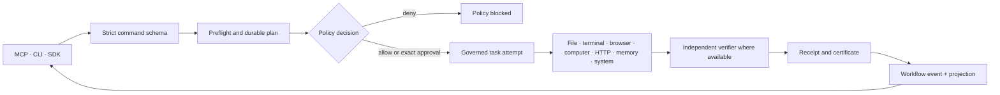

# Architecture

MELRA is a local-first autonomy kernel: the layer an agent asks to change the
world through, rather than a layer that decides what to change. MCP, CLI, SDK,
loopback HTTP, and Unix-socket callers use the same task and workflow services; no interface
bypasses schema validation, policy, approval, budgets, verification, or durable
evidence.

## Responsibility boundary

There are three layers, and the dividing line is *reasoning* against *effects*.

| Layer | Owns |
|---|---|
| **LLM** | Reasoning, tool selection, planning |
| **Agent harness** | Conversation, prompt construction, model routing, semantic memory, agent personality, subagent reasoning |
| **MELRA** | Effect authorization, effect execution, durable effect state, recovery, verification, evidence, credentials and capabilities |

MELRA begins where the tool call leaves the model loop. It deliberately has no
model client, planner, or reasoning loop. Adding one would put it in competition
with the harnesses it is supposed to serve, and would make the guarantees below
depend on a model's judgement.

The consequence for code: nothing in `packages/` may call an LLM, and no
decision in the execution path may depend on model output. Evidence predicates
are deterministic by construction for exactly this reason — see
[verification levels](#verification-strength).

A corollary that decides most scope questions: MELRA never receives a goal.
"Fix the production server" requires judgement about what is broken; the model
resolves it to a bounded operation — effect `terminal.execute`, command
`systemctl restart api`, environment `production` — and that is what arrives at
the kernel.

## Effect lifecycle

Every effect, from any interface, walks the same stages. Stages in **bold** can
refuse; the rest can only record.

```text
REQUEST      a caller submits a strict, bounded operation schema
NORMALIZE    schema validation, path resolution, classification
IDENTITY     which principal asked, on whose behalf
CAPABILITY   what this principal may reach at all
PREFLIGHT    adapter capability discovery and cheap feasibility checks
RECORD       durable TaskRecord written before anything runs
POLICY       allow · deny · confirm, on effect and risk
APPROVAL     task-scoped and bound to the action digest: an exact phrase in
             developer mode, an operator's out-of-band decision in enforced mode
CREDENTIALS  the kernel acquires what the effect needs; the caller never sees it
IDEMPOTENCY  logical attempt key; a committed attempt is not re-run
EXECUTION    the adapter runs under an AbortSignal and a budget
OBSERVATION  raw adapter result, redacted before persistence
VERIFICATION independent predicates decide success, not the adapter
COMMIT       terminal status, events, projection, certificate
RECEIPT      redacted, hash-linked evidence retained locally
RESULT       returned to the caller
```

`melra_plan` stops after `APPROVAL` and returns the challenge.
`melra_execute` **re-runs** `CAPABILITY` and `POLICY` before `EXECUTION`, so a
plan cannot ride a policy that has since been tightened.

`IDENTITY` and `CAPABILITY` are real stages but weak ones: the principal is a
claim the caller makes rather than something MELRA authenticates, and grants are
checked only where an operator has issued them. `CREDENTIALS` is real for HTTP:
secrets an operator configured under `policy.credentials` are injected by the
kernel at send time, scoped by host and capability, and never returned to the
caller ([P4](../ROADMAP.md#p4--credentials-and-api-effects)). Other adapters
still use the ambient process environment, so an agent that can reach the
kernel can reach whatever the kernel's process can. Authenticating identity is
[P2](../ROADMAP.md#p2--hard-capability-boundary) work, listed here because the
lifecycle is the contract even where the implementation is still one step.

## Effect contract

The stages above each read a field of one object. `EffectContract` is what those
fields are called together:

```ts
interface EffectContract {
  contractVersion: string;
  taskId: string;
  identity: Identity;          // who asked, on whose behalf
  capability: string;          // file.write, terminal.run, browser.click
  operation: Operation;        // the strict, bounded schema
  effect: Effect;              // read · mutate · destructive
  risk: Risk;
  target: string;
  traits: CapabilityTrait[];   // package-install, network
  forbiddenEffects: Effect[];  // limits the caller placed on itself
  postconditions: EvidencePredicate[];
  budget: TaskBudget;
  idempotencyKey?: string;
  policy: PolicyDecision;
  authorization?: ApprovalChallenge;
  metadata: { goal: string };
}
```

It is **derived from a persisted task, never supplied**. `melra_plan` returns it
alongside the record it was derived from, so what a caller reads before
approving is the same object the execution path will load. A second
input path that could describe an effect differently from the one about to run
would be a way around the approval, not a convenience.

## Identity and capability grants

`identity` is optional on a request: `{ principal, onBehalfOf }`, where
`principal` is the immediate caller and `onBehalfOf` is the chain behind it,
outermost first — organization → human → harness → parent agent. A request that
declares none is the local principal, `agent:local`. Every receipt records the
chain as one line (`organization:acme/human:dheeraj/agent:claude-code`), so a
receipt answers *who authorised this*, not only *what ran*.

MELRA authenticates exactly one link. Over loopback HTTP a client that completed
the OAuth flow ([installation](INSTALLATION.md#clients-that-let-themselves-in))
is recorded as `harness:<name>#<id prefix>` at the outermost end of the chain,
ahead of whatever the request declared — because anything a client names, a
session or a subagent, is inside it and never above it. Every other link is a
claim the layer above makes, worth exactly what that layer's own boundary is
worth, which over stdio is nothing. Enforced mode
([P2](../ROADMAP.md#p2--hard-capability-boundary)) is where the rest of the
chain becomes fact rather than claim.

`policy.capabilities` turns that identity into bounded authority. Each grant
names a capability pattern, the effects allowed under it, a target pattern, the
holder, and optionally `validUntil` and `policyVersion`. An empty list — the
default — means no narrowing. A non-empty list is a closed world, checked before
any allowlist: authority comes first, because the allowlists describe what a
grant holder may do, not whether they hold one. A grant is matched against the
immediate principal, which is a link the caller declares, so it narrows what a
cooperating caller can reach rather than standing between it and the effect.

## Execution boundaries



A command requests a transition. Accepted workflow transitions append events
and update the current projection in one `BEGIN IMMEDIATE` SQLite transaction.
Events are the ordered facts; the projection serves status reads; snapshots
accelerate replay at checkpoints but do not replace event history.

Planning never executes an adapter. Task execution re-evaluates policy and
revalidates an approval against the current action digest immediately before
the effect.

Unsafe-local mode removes the `Policy` diamond and the runtimes' confinement, leaving
the rest of the chain intact: tasks are still planned, executed, verified against
whatever evidence the caller declared, and receipted. It is implemented by
short-circuiting `evaluatePolicy` to `allow` and by rooting the file runtime,
terminal runtime, and verifier at the filesystem root instead of the workspace —
not by adding bypass branches to the confinement code, which keeps exactly one
behaviour. See [unsafe-local mode](INSTALLATION.md#unsafe-local-mode).

## Durable storage

MELRA uses `<MELRA_HOME>/melra.sqlite` in WAL mode. Schema migration version
`1` adds the durable workflow and payload tables.

| Table | Authority |
|---|---|
| `schema_migrations` | Applied durable-schema versions |
| `tasks` | Redacted task projections |
| `task_payloads` | Encrypted exact task requests and optional results |
| `receipts` | Redacted action evidence |
| `certificates` | One terminal execution certificate per task |
| `memories` | Scoped, redacted local memory |
| `workflow_definitions` | Redacted immutable workflow definitions |
| `workflow_payloads` | Encrypted exact workflow definitions by version |
| `workflow_runs` | Current workflow projections and state versions |
| `workflow_events` | Append-only aggregate events with unique sequence |
| `workflow_snapshots` | Validated checkpoint projections |
| `idempotency_commits` | Unique committed logical task attempts |

Workflow creation persists the redacted definition, encrypted definition,
initial projection, and first two events atomically. Later transitions use
compare-and-swap on `state_version`; stale writers fail with
`workflow_state_conflict`.

## Encrypted executable payloads

Exact task requests, task results, and workflow definitions are canonicalized
and sealed with AES-256-GCM. A random 96-bit IV is used for every envelope.
Authenticated additional data binds ciphertext to its task or workflow
identity, version, and purpose, preventing record substitution.

The 256-bit key comes from one of two sources:

- `MELRA_PAYLOAD_KEY`, encoded as canonical base64url; or
- `<MELRA_HOME>/payload.key`, created atomically with mode `0600` inside a
  mode-`0700` data directory.

On Unix, an existing key with group/other permissions is rejected. Symlinks
and non-regular key files are rejected. Losing or changing the key makes
existing payloads unreadable. MELRA does not escrow or recover keys.

Status, events, logs, receipts, and certificates contain redacted projections,
not executable plaintext. `MELRA_HOME` still contains sensitive encrypted
material and must not be committed or publicly synchronized.

## Workflow model

A definition is an immutable, versioned DAG with at most 500 nodes. Node IDs
are unique; dependencies must exist; self-dependencies and cycles are rejected
before persistence. Every nested task is capability- and policy-preflighted
before the workflow is accepted, and a `condition`, `until` or `delegation`
check no registered verifier can ask (`evidence_verifier_unavailable`), or on a
file path outside the workspace (`evidence_path_outside_workspace`), is refused.

| Node | Implemented semantics and bounds |
|---|---|
| `operation` | One governed task request |
| `approval` | Plans the target operation and pauses for its exact scoped challenge |
| `condition` | Re-verifies a persisted source result, then executes at most 50 requests from the selected branch |
| `parallel` | Executes 2–20 independent branches concurrently, each with 1–50 sequential requests |
| `bounded_loop` | Executes 1–50 body requests for at most 100 iterations and may stop on a persisted predicate |
| `checkpoint` | Emits `workflow.checkpoint_saved` and stores a validated snapshot |
| `compensation` | Runs a governed compensating request after its verified target is followed by a step that fails or is denied |
| `human_input` | Blocks in `awaiting_input` until `advance` supplies a value within `maxLength` and, where declared, within `choices` |
| `delegation` | Blocks in `awaiting_input` until an outside worker reports back; the node's own `requiredEvidence` decides the outcome |

The total definition limit is 500 nodes; each node may declare at most 100
dependencies. A task budget allows at most 100 steps, 900 seconds, and 10 read
retries. Mutations are never automatically retried.

A delegate reporting "done" is not evidence. A `delegation` node that declared
predicates and whose predicates fail is `failed`, exactly as an `operation`
node would be.

A check whose provider did not answer is not a "no". When a `condition`'s
predicate, a `bounded_loop`'s `until` or a `delegation`'s evidence comes back
`inconclusive` (a 503 or 429, a 401 or 403, a redirect, a refused destination,
a body cut at the size cap, no connection), nothing is decided: `advance`
records the other nodes and fails with `workflow_check_inconclusive:<node>`.
The condition stays `pending` and runs neither branch, the loop stays `pending`
with the iterations it ran, and the delegation stays `awaiting_input` and keeps
the report it was sent; each names the check it waits on as its `error`, by
type and source (a URL without its query, which can carry a token), so status
shows what the run waits on. Every later `advance` asks again, and one still
unanswered writes nothing, however the provider words its failure. A definite
no among several items decides even while another is unanswered. A provider
that never answers holds the run there; `workflow cancel` ends it, and does not
compensate, so effects already done stay done. A check the kernel refuses to
ask (an `unanswerable` item: a URL `{{token}}` its source result cannot fill, a
verifier gone since planning, a reserved path) is refused again of the same
result, so a `condition` or `delegation` fails
(`workflow_check_unresolvable:<node>`) and the run unwinds. A loop's `until`
asks of each iteration's new result, so it reads such a check as a no and runs
the next iteration, up to `maxIterations`.

## Workflow state and events

Workflow statuses are:

```text
draft → planned → running → verified_complete
                  ↘ awaiting_approval
                  ↘ awaiting_input
                  ↘ paused        (operator, resumable)
                  ↘ suspended     (operator, resumable)
                  ↘ recovery_required
                  ↘ failed
                  ↘ cancelled
```

`paused` and `suspended` are entered by the operator commands `workflow pause`
and `workflow suspend`, and left by `workflow resume`; an `advance` against
either is refused rather than queued. The public schema also reserves
`partially_complete`, which no command enters today.

`cancelled` is entered only by `workflow cancel`. A step whose task is denied
before it runs (`melra approve --deny`, the console's Deny, or
`melra_task_cancel` on a task still planned or waiting) did not happen, so its
run is `failed`, as for a step that failed, and unwinds (see
[Sagas across providers](#sagas-across-providers)), unless another step's
outcome is unknown. Cancelling a step that is already running aborts it, and
its outcome may then be unknown (`recovery_required`). A step whose record and
effects disagree, cancelled as a duplicate of an attempt that committed or
still running or verifying, makes the run `recovery_required` until recovery
settles it. Recovery runs whenever the runtime starts: `melra serve` (each stdio
session is one), any `melra workflow` command, `approve`, `run`, `console`,
`inspect`, `export` and `demo`. `status`, `tasks` and `watch` only read the
store.

Implemented event types are:

- `workflow.created`;
- `workflow.status_changed`;
- `workflow.node_changed`;
- `workflow.checkpoint_saved`;
- `workflow.recovered`;
- `workflow.recovery_required`;
- `workflow.paused`;
- `workflow.suspended`;
- `workflow.resumed`;
- `workflow.cancelled`.

Sequences start at one and increase without gaps per workflow. Event replay
rejects duplicate, missing, reordered, or corrupt history. A corrupt snapshot
may be ignored only when full event replay succeeds.

## Restart, uncertainty, and concurrency

At startup, task recovery runs before workflow recovery and before any public
interface is served.

- Planned and approval-waiting payloads remain executable after restart.
- Interrupted reads return to `planned` and may retry within their original
  budget and idempotency identity, unless the read had already verified and
  committed its key: then it recovers as `verified_success`
  (`committed_before_interruption`) and is not run again.
- A mutation in `verifying` may become `verified_success` only when all
  required predicates are independent filesystem observations
  (`file_exists`, `file_absent`, or `file_hash`).
- Other interrupted mutations enter `recovery_required`; MELRA does not repeat
  them automatically.
- A verified task committed before its workflow projection is repaired from
  persisted task evidence and recorded as `workflow.recovered`.
- Idempotency keys bind workflow, node, iteration, branch, and canonical
  request. SQLite rejects a second committed attempt.
- Competing advances for one workflow are serialized inside a server process.
  Concurrent independent branches remain parallel.

Multiple MELRA server processes may share one `MELRA_HOME`. Advancing a workflow
takes an expiring SQLite lease before any adapter runs, so a second process is
refused with `workflow_lease_held` rather than starting duplicate side effects.
The advance renews that lease before each step it starts and before it commits.
One that stalled long enough for another process to take the run over fails
with `workflow_lease_lost` instead, starting no further step and committing
nothing; advancing again carries on from wherever the other process left it.

Recovery touches only work whose process is gone. The process that starts a
task records itself as the task's owner and holds an exclusive lock on a file
named for it in `melra.sqlite-owners/`; the operating system releases that lock
however the process ends. Recovery claims a task only when its owner's lock is
free, with a compare-and-set so two recoverers cannot both take it, and touches
a workflow run only under that run's lease and only once none of its tasks is
still running. A running runtime sweeps every 30 seconds for work left by a
process that died after it started. An advance that finds an expired lease
recovers the run before taking it over, so it never plans again a task the dead
advance already started. A process also retakes its own task when nothing in it
is still working on that task, for example after the task's last write failed.
The next process to take a lock removes the lock files that dead processes left.

The file runtime and the verifier refuse MELRA's own database files, the lock
directory, and `payload.key`, even when the workspace contains the data
directory. On POSIX, opening and closing one of those files in the server
process would drop that process's locks on it.

## Public interfaces

MCP is one way into the kernel, not the definition of it. Every interface
below enters the same runtime, takes the same policy decision, and writes the
same durable record; none of them is a shortcut past a stage of the lifecycle.

| Interface | Transport | Intended caller |
|---|---|---|
| MCP | stdio | An MCP client spawning the server as a subprocess |
| MCP | Streamable HTTP on loopback | A client that cannot spawn processes |
| MCP and JSON API | Streamable HTTP on a mode-`0600` Unix socket | A sandboxed harness on the same host, as its only door |
| CLI | argv | Humans, scripts, CI |
| TypeScript SDK | stdio subprocess, or a running server over loopback HTTP or the Unix socket | Node applications and custom harnesses |
| Python SDK | stdio subprocess, or a running server over loopback HTTP or the Unix socket | Python applications and custom harnesses |
| JSON API | loopback HTTP or the Unix socket, read-only | Consoles and dashboards |
| Approval console | `melra console`: its own loopback HTTP server, no MCP endpoint | An operator approving or denying in a browser tab paired with it |

The MCP surface is exactly eleven tools:

| Task tools | Workflow tools |
|---|---|
| `melra_capabilities` | `melra_workflow_plan` |
| `melra_plan` | `melra_workflow_advance` |
| `melra_execute` | `melra_workflow_status` |
| `melra_task_status` | `melra_workflow_cancel` |
| `melra_task_cancel` | `melra_workflow_control` |
| `melra_receipt` |  |

The CLI exposes `workflow plan`, `workflow advance`, `workflow inspect`,
`workflow cancel`, and the operator halts `workflow pause`, `workflow resume`,
and `workflow suspend`; `tasks`, `watch`, and `status` read the local database
read-only, with or without a server running. `approve` and `console` record an
operator's decision through `TaskController.decide`, the first in a terminal
and the second in a browser tab; the server an agent connects to has no route
that does. The TypeScript and Python SDKs call the same workflow
tools and do not implement a second execution engine.

## Packages

Kernel services own the guarantees. Reference effect adapters are replaceable
implementations that must pass through those services to reach anything.

| Kernel service | Responsibility |
|---|---|
| `@melra/protocol` | Strict task, workflow, event, approval, and MCP contracts |
| `@melra/runtime-core` | Task execution, workflow transitions, recovery, and replay |
| `@melra/policy-core` | Allow/deny/confirm policy and approval validation |
| `@melra/storage-sqlite` | Transactional local authority |
| `@melra/verifier-core` | Deterministic evidence evaluation |
| `@melra/receipt-schema` | Canonical receipts, certificates, hashes, and redaction |
| `@melra/memory` | Operational memory: scoped local retrieval, lifecycle, redaction |
| `@melra/server` | Runtime composition and the MCP/HTTP/Unix-socket transports |

| Reference effect adapter | Effects it can perform |
|---|---|
| `@melra/file-runtime` | Root-confined filesystem operations |
| `@melra/terminal-runtime` | Shell-free process and background-job control |
| `@melra/browser-runtime` | Isolated Playwright browser execution |
| `@melra/computer-runtime` | Typed local computer-use adapters |
| `@melra/http-runtime` | One bounded HTTP request, pinned to a checked address |

`@melra/sdk` is a client of the kernel rather than a part of it.

`@melra/memory` is operational memory — what MELRA knows about its own
effects. Semantic memory about the *user* (preferences, project context,
conversation) belongs to the agent above and is deliberately out of scope.

## Verification strength

Success is decided by evidence, never by the adapter's own report. How much a
piece of evidence is worth depends on where it came from, and MELRA states that
rather than flattening it into a boolean:

| Level | Name | What it is | Example | Shipped |
|:--:|---|---|---|:--:|
| 0 | **Execution** | The adapter's own report | exit code `0`, HTTP 200, no exception | ✓ |
| 1 | **State** | MELRA re-reads the target itself | `file_exists`, `file_hash` re-reading the workspace | ✓ |
| 2 | **Independent** | A different channel to the same fact | `http_resource_matches`: execute via `POST /refund`, verify via `GET /refund/:id` | ✓ |
| 3 | **Semantic** | A judgement about meaning | "the summary is accurate" | roadmap, and **probabilistic** |

Execution evidence is the weakest: it says the call returned, not that the world
changed. Independent verification is much stronger precisely because the channel
that performed the effect is not the channel that confirms it.

Every evidence item on a certificate carries its level in a `strength` field, so
a caller reading a receipt can tell the actor's own word from the world's
answer without knowing the predicate table by heart. The level is **derived from
the predicate type** by `evidenceStrength()` in `@melra/receipt-schema` and
stamped once in the verifier — never declared by the caller, because evidence a
caller could label `independent` itself would prove nothing. An unrecognised
type — an older receipt, or a predicate added without a decision in that table —
reads as `execution`, the weakest claim, rather than silently borrowing a
stronger one.

Semantic verification will be labelled probabilistic wherever it appears, and
will never be the sole evidence for a destructive effect. A verifier that
guesses is useful; a verifier that guesses while presenting itself as proof is
worse than none.

## Execution guarantees

Distributed systems did not become easy because an LLM is calling them. MELRA
states which guarantee an effect actually carries rather than implying
exactly-once everywhere:

| Guarantee | Meaning | Where it applies today |
|---|---|---|
| `read-only` | No state change; safe to retry | Reads, which are the only retried effects |
| `at-most-once` | Executed zero or one times; never retried | Every mutation and destructive operation |
| `at-least-once` | May execute more than once; the effect must tolerate it | Not used |
| `provider-idempotent` | Exactly-once because the provider accepts an idempotency key | Not derived yet: the HTTP adapter sends `Idempotency-Key`, but MELRA cannot check a provider honours it |
| `reconciliation-required` | Outcome may be unknown; settled by re-reading the provider rather than re-running | A request that declared `reconciliation` predicates, and interrupted mutations without independent file evidence |
| `compensatable` | Undone by a declared inverse effect | Not derived on a single task yet; `compensation` workflow nodes provide the inverse |

The plan publishes the value as `contract.executionGuarantee` and the receipt
repeats it, so a caller learns a write will not be retried *before* it approves
one, and an auditor reads the promise beside the outcome. It is derived from the
classified effect and never accepted from the caller — a caller that could
declare its own `POST` `provider-idempotent` would have bought itself a retry it
is not entitled to. The executor asks the guarantee rather than re-deriving the
rule, so the published promise and the retry loop cannot drift apart.

`reconciliation-required` is the one value a caller influences, and only by
giving MELRA more to work with: declaring `reconciliation` predicates does not
buy a retry — the effect still runs at most once — it says how an outcome MELRA
could not observe should be settled. That is a different promise from
`at-most-once`, which says the effect ran zero or one times without saying
which, so the plan states it separately.

Beside it, every receipt carries `mode` — `developer` or `enforced`. It says
nothing about the request; it records how the kernel that ran the effect was
deployed, which is the difference between "governed by the only door" and
"governed by one of several". That is not recoverable after the fact, so it is
written at the same time as the outcome rather than left for an auditor to infer.
See [deployment modes](INSTALLATION.md#deployment-modes).

A receipt for an approved effect also says who approved it and how:
`policyDecision.approval` holds the `channel`, the `approver`, when they decided,
and `renderDigest`, the digest of the effect contract they were shown. An echoed
phrase is `in_band` with approver `phrase`, because anything that knows the task
can compute it. A decision recorded through an operator surface
(`TaskController.decide`, which `melra approve`, `melra run`'s prompt and
`melra console` call; the approver reads `cli:<name>` or `console:<name>`) is
`out_of_band` only in enforced mode, and is bound to the render: a request that
changed after it was shown cannot run on it.
Decisions live in their own insert-once table, and one made before the
challenge expired stays usable for a TTL after it was made.

Enforced mode issues no phrase at all: the challenge has the approval id, the
task id, the action digest and the expiry, and nothing the agent could echo.
`melra_execute` refuses any approval a caller sends
(`approval_in_band_refused`) and runs only on an `out_of_band` decision;
without one it answers `approval_awaiting_operator`, or `approval_expired` once
the challenge has expired. An in-band decision row counts as none there, and a
developer-mode process asked to decide a task that has no phrase refuses
(`approval_needs_enforced_mode`) rather than spend its one decision on a row
the enforced kernel would ignore. The certificate
carries `mode` and `approvalChannel` (`not_required` for a read, `bypassed` for
a mutation unsafe-local allowed with no challenge, otherwise the receipt's
channel), sealed by its digest like every other field.

## Outcomes MELRA cannot observe

A mutation whose reply never arrives is the case where a kernel is most tempted
to lie. `failed` reads as *the effect did not happen*, and after a request that
went out and was never answered, that is a claim nobody holds.

The discriminator is whether the request reached the wire. A DNS failure or a
refused connection means the bytes never left, so `failed` is true. A request
written to the socket and left unanswered means the far end may have done the
work and lost the reply, so the adapter marks the error
`effect_outcome_unknown:` and the task parks as `recovery_required` — the
receipt's evidence carries `inconclusive: true`, and the certificate says
`RECOVERY_REQUIRED` rather than `FAILED`. Reads are exempt: a read that may or
may not have run changed nothing either way.

The same holds for a program stopped mid-run. A terminal `run` stopped by its
own `timeoutMs`, as by the task's budget or a cancel, may have written its file
or pushed its branch first, and a computer input helper (click, move, drag,
type, key, scroll) stopped by its timeout or a cancel may already have landed.
Each is `effect_outcome_unknown:`, not `failed`.

A mutation whose adapter returned, but whose result, receipt or task could not
then be written, parks the same way: the target answered, and nothing recorded
says what. One that had already verified and committed its idempotency key is
settled by that commit, which is written only once the effect verified:
reconciling it asks nobody and it becomes `verified_success`
(`committed_before_interruption`), declared `reconciliation` or not. A workflow
step whose outcome was recorded but whose certificate was not gets it at the
run's next advance, so the run still finishes. Only what writes the run (an
advance, recovery, a resume) writes it, and only if none is stored yet, as
`execute` writes its own: reading receipts writes nothing, and no two
processes hand out different certificates for one task.

Settling a parked task is what `reconciliation` predicates are for. They are
read against the facts that were true *before* the call — the task id, the URL,
the method, the `idempotencyKey` MELRA sent — because a lost reply left no
response to interpolate from. Calling `melra_execute` on a parked task
reconciles instead of re-running, so a caller retrying the obvious way gets the
safe thing:

| Provider says | Task becomes |
|---|---|
| the effect is applied | `verified_success`, receipted as `recovered` |
| no such effect | `failed`, `reconciliation_confirms_effect_not_applied` |
| nothing — unreachable | stays `recovery_required`, `reconciliation_inconclusive` |
| nothing — the kernel refuses to ask | stays `recovery_required`, `reconciliation_unanswerable:<refusal>` |
| *(none declared)* | stays `recovery_required`, `reconciliation_not_declared` |

An unreachable provider did not say no, so nothing is concluded from silence.
A predicate the kernel itself refuses to ask — a path outside the workspace or
one the filesystem will not take whole, a URL token with nothing to fill it, a
verifier this runtime lacks — is
inconclusive too, and its item also carries `unanswerable: true`, because
asking again is refused again; a caller deciding whether to wait reads that
flag, never the summary, and the task's `error` names it
(`reconciliation_unanswerable:` and the refusal) so the declaration gets fixed
rather than waited on. Planning refuses a file path that could only be
refused (`evidence_path_outside_workspace`), and a URL token those four facts
cannot fill (`reconciliation_unanswerable:verification_token_unresolved:<token>`).
The same path runs on restart: `recoverInterrupted` reconciles a crashed
mutation that declared how to settle one, and parks the rest.

A forward workflow step parked this way moves at the run's next `advance`, in
the same process: the advance reads the step's tasks again, as recovery does.
Settled as applied, the step is done and what waits on it runs; settled as not
applied, it failed, and the run fails and unwinds. A parked compensation is
covered under [Sagas](#sagas-across-providers).

## Sagas across providers

A compensation node is an ordinary governed task whose request may name any
host, so undoing a charge at one provider and a shipment at another needs no
special code — policy, approval, and the compensation's own declared evidence
all still apply.

What does need care is order. Compensations undo each other's preconditions:
cancel the shipment before refunding the charge that paid for it. They run one
at a time, newest effect first, and the unwind stops at the first that does not
reach `compensated` — refunding while the goods are still in transit is worse
than stopping. A stalled unwind makes the run `recovery_required` with
`workflow_compensation_incomplete:<node>` naming the missing inverse, and
`advance` refuses to start new work on top of it. Once `melra_execute` settles
that compensation as applied, the next `advance` marks it `compensated` and the
unwind carries on; settled as not applied, the unwind stays stalled.

A step denied before it runs starts the same unwind as a failed one. Neither
starts while another step's outcome is unknown or unsettled (an effect that may
have happened, or a task still running): the run is `recovery_required` and
waits, starting no further step, rather than undo what that effect may depend
on. That step is settled by its `reconciliation`: `melra_execute` on its task,
or recovery when a process starts, asks the provider whether the effect
happened. Once settled, the next `advance` fails the run and unwinds, the
settled step's own compensation included if its effect happened. A step that
declares no `reconciliation` cannot be settled by MELRA; `workflow cancel` ends
such a run, without unwinding it. Each
compensation is still its own governed task, so one that is a mutation waits for
its own approval, and denying it stops the unwind as a failed compensation does.
To end a run without unwinding it, cancel the run (`workflow cancel`,
`melra_workflow_cancel`); that also stops an unwind already under way, before
its next compensation.

An interrupted mutation becomes `recovery_required` rather than being repeated,
because the durable record can say what was in flight but not what the provider
did with it. Recovery asks *what do the durable facts say happened*, never
*what did the model probably mean*.

## Deployment modes

| | Developer mode | Enforced mode |
|---|---|---|
| Boundary | A policy file the caller can edit | Not reachable by the caller |
| Harness | Holds credentials, may also hold native tools | Sandboxed, no privileged secrets, no raw production shell |
| Transport | stdio, loopback HTTP, or a Unix socket | Token-authenticated IPC: a mode-`0600` Unix socket or loopback, never a public bind |
| Status | Shipped | `MELRA_MODE=enforced` ships the refusals MELRA owns; the OS isolation around the harness is the operator's ([P2](../ROADMAP.md#p2--hard-capability-boundary)) |

Developer mode is the honest default for adoption: MELRA is a governed path, and
a harness that also has an unrestricted native terminal can simply not use it.
That is a useful convenience, not a trust boundary, and this repository does not
claim otherwise.

Enforced mode makes MELRA the only path by taking the alternatives away —
containers, separate OS users, filesystem ACLs, namespaces, network isolation,
sandbox profiles, credential isolation, Unix sockets, service identities.
Those are operating-system primitives; MELRA should use them rather than
reinvent them. Linux governs access to machine resources. MELRA governs
autonomous effects performed through those resources.

## Verification boundary

Filesystem predicates independently re-read the workspace (level 1), and
`http_resource_matches` asks the provider over a second request (level 2).
Result, terminal, URL, and page predicates evaluate adapter-returned
observations (level 0). Predicates are caller-authored, so a weak predicate can
prove too little. Models and adapters cannot approve actions or mark a workflow
complete, but MELRA is not yet an independent semantic judge of arbitrary goals.

See [THREAT_MODEL.md](THREAT_MODEL.md) and
[COMPATIBILITY.md](COMPATIBILITY.md) for residual risks and alpha guarantees.
